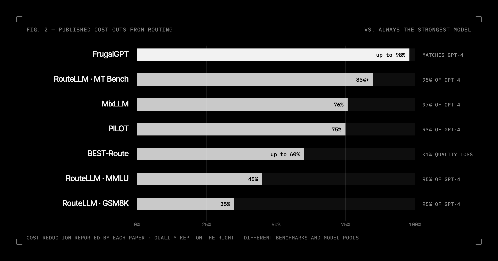
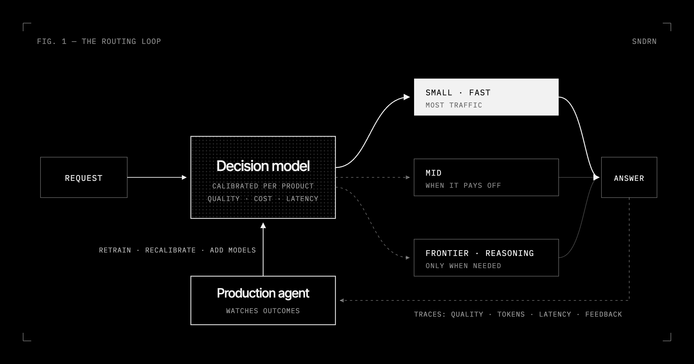

Every LLM request hides a decision. Which model should answer it? Does it need a reasoning
model, or will a small, fast one do? How many tokens is the answer worth?

In most products that decision is made once, in a config file, and never revisited: one model
for everything, or a default router someone else trained. Both are expensive ways to be wrong.

## A bigger menu, a bigger bill

Enterprises spent **$12.5 billion on foundation-model APIs in 2025**, out of $37 billion in
total generative AI spend, which tripled in a year [[1]](https://menlovc.com/perspective/2025-the-state-of-generative-ai-in-the-enterprise/).
That happened while the price of any fixed level of capability fell between 9x and 900x a
year, depending on the task [[2]](https://epoch.ai/data-insights/llm-inference-price-trends).
Cheaper tokens didn't shrink the bill. More tokens grew it:

- **Reasoning models write about 8x as many output tokens** as other models on the same
  benchmark questions [[3]](https://epoch.ai/data-insights/output-length), and in 2025 they went
  from almost nothing to more than half of all tokens on OpenRouter
  [[4]](https://openrouter.ai/state-of-ai).
- **The menu changes every week.** OpenRouter lists 425 models from 56 publishers; 107 of
  them arrived in the last 90 days [[5]](https://openrouter.ai/models).

So the useful question isn't which model is best. It's which model is best *for this request*,
at this cost and this latency. That is a routing problem.

## What routing is worth

Research keeps finding the same thing: most requests don't need the most expensive model.

- A learned cascade matched GPT-4 at **up to 98% lower cost** [[6]](https://arxiv.org/abs/2305.05176).
- Routers trained on preference data kept **95% of GPT-4's quality** while cutting cost by
  **over 85%, 45% and 35%** on three benchmarks [[7]](https://lmsys.org/blog/2024-07-01-routellm/).
- Routers that keep learning from feedback reached **97% of GPT-4's quality at 24% of its cost**
  [[8]](https://arxiv.org/abs/2502.18482), and **93% at 25% of its cost** under a hard budget
  [[9]](https://arxiv.org/abs/2508.21141).
- Choosing both the model and how much to sample cut cost by **up to 60% with under 1% quality
  loss** [[10]](https://arxiv.org/abs/2506.22716).

Put it in dollars. At the low end of those results, 35%, routing the $12.5 billion enterprises
spent on model APIs in 2025 would be worth more than $4 billion a year. For a company spending
$1 million a year on model APIs, 35–85% is $350,000 to $850,000 a year. One market estimate
expects routing products alone to grow from about $100 million in 2025 to $4.1 billion by 2035
[[11]](https://www.astuteanalytica.com/industry-report/ai-model-router-market).

## Routing is a decision problem

A router is a decision model. For each request and each candidate model, it estimates how
likely that model is to produce an acceptable answer, what it will cost and how long it will
take, and picks the option that maximizes quality within your budget. Reasoning effort belongs
to the same decision: "use the large model, but don't think" is a valid route.

The largest deployments already work this way. In ChatGPT, GPT-5 is a fast model and a
reasoning model joined by a real-time router that decides from conversation type, complexity,
tool needs and explicit intent [[12]](https://openai.com/index/gpt-5-system-card/). The open
vLLM Semantic Router sends simple prompts down a fast path and reserves reasoning for complex
ones; its authors report 48.5% fewer tokens and 47.1% lower latency
[[13]](https://arxiv.org/abs/2510.08731). Arch-Router, a 1.5B-parameter model, routes by domain
and action rules that teams write themselves [[14]](https://arxiv.org/abs/2506.16655).

## Why default routers fall short

A router is only as good as the data it learned from, and default routers learned from
someone else's.

**They learned someone else's idea of "hard".** Trained on public chat preferences alone,
RouteLLM's routers did no better than random on MMLU; adding about 1,500 in-domain labels,
under 2% of the training data, cut GPT-4 calls by about 20% compared with random routing at the same quality
[[15]](https://arxiv.org/abs/2406.18665). Routers that predict which model will be right fall to
about 59% accuracy on unseen tasks, and up to 50 labels from the target task lift them to about 65%
[[16]](https://arxiv.org/abs/2309.15789). A 2026 study of 21 routers found they mostly learn
which models are good on average: 300,000 more generic training queries added 1.24 points
[[17]](https://arxiv.org/abs/2606.07587).

**They aren't optimizing your bill.** In an open comparison, commercial routers were more
accurate but far more expensive, and one picked the cheapest correct model only 1.6% of the
time [[18]](https://arxiv.org/abs/2510.00202). OpenRouter's Auto Router sorts each prompt into
about 30 task types, then picks models by what everyone on the platform spent on over the past
week [[19]](https://openrouter.ai/openrouter/auto). That's a sensible default, not your quality
bar.

**Their scores aren't calibrated for your thresholds.** A router outputs a score and you pick a
threshold. Modern networks are systematically overconfident until they're recalibrated
[[20]](https://arxiv.org/abs/1706.04599), and post-training raised GPT-4's calibration error on
an MMLU subset from 0.007 to 0.074 [[21]](https://arxiv.org/abs/2303.08774). Cascades degrade
quickly once the judge deciding when to escalate is wrong more than 20% of the time
[[22]](https://arxiv.org/abs/2403.12031). If the score isn't a calibrated probability on your
data, cost and quality targets turn into guesswork.

**The models move under you.** Beyond a hundred new models a quarter, the same model name
drifts: GPT-4's accuracy at identifying prime numbers fell from 84% to 51% in three months
[[23]](https://arxiv.org/abs/2307.09009). A router's picture of each model goes stale.

The largest deployment points at the fix. OpenAI says GPT-5's router is continuously trained on
real signals, including when users switch models, preference rates and measured correctness
[[12]](https://openai.com/index/gpt-5-system-card/). The best routers learn from production.

## Every company needs its own router

No two companies route the same traffic under the same constraints:

- **Providers and contracts.** Enterprise API usage is split across Anthropic (40%), OpenAI
  (27%) and Google (21%) [[1]](https://menlovc.com/perspective/2025-the-state-of-generative-ai-in-the-enterprise/),
  often with committed spend or credits on one of them.
- **Privacy and residency.** Some data can only go to open-weight models you host yourself.
- **Latency and reasoning budgets.** A support chat and a nightly research job tolerate very
  different response times and token counts.
- **Your own mix.** Legal research in Portuguese, contract extraction, code review and agent
  tool calls each have their own failure modes.

A router trained on the internet's average can't see any of that.

## Decision models are becoming the base layer

A new class of models is built to make exactly this kind of choice: TypeSafe's JEV, trained for
calibrated decisions [[24]](https://typesafe.ai/blog/introducing-system-one-models-and-jev), and
the open Decision and Vela routing models from vLLM Semantic Router
[[25]](https://github.com/vllm-project/semantic-router). They're a strong place to start. They
don't know your product.

## A base decision model, plus an agent that watches production

That's what we're building at SNDRN.

**A base decision model.** Every product starts from a fast decision model, milliseconds rather
than seconds, that predicts for each request and each candidate model the probability of an
acceptable answer, the expected tokens and the latency. It's calibrated, so a threshold of 0.9
means 90%, and it starts from broad public data, so it works on day one.

**An agent that listens to production.** Then an agent runs the loop:

- samples production traces: inputs, routes, outputs, tokens and latency;
- labels outcomes with task-specific checks, LLM judges on sampled pairs, and real user signals
  such as retries, edits and escalations;
- detects drift: new intents, new languages, new failure modes, models that changed;
- tests new models in shadow on your real traffic before they serve a single user;
- retrains and recalibrates the decision model for your product;
- ships every update behind a canary, with automatic rollback.

Routers that keep learning hold up: online-learned cascades matched LLM accuracy at up to 90%
lower cost and stayed robust as inputs shifted [[26]](https://arxiv.org/abs/2402.04513), and the
feedback-driven routers above kept 93–97% of GPT-4's quality at a quarter of the cost
[[8]](https://arxiv.org/abs/2502.18482) [[9]](https://arxiv.org/abs/2508.21141).

**Your objective, not ours.** You set the target, for example "match frontier quality on 95% of
requests at the lowest cost", "p95 latency under 1.5 s" or "reason only when it changes the
answer", and the agent optimizes the decision model against it, week after week.

## What changes

- **Faster.** Most traffic goes to small, fast models, and reasoning happens only when it pays
  off.
- **More accurate.** Escalation follows calibrated risk on your data, not keyword rules or
  someone else's benchmark.
- **Cheaper.** Fewer tokens, from smaller models, fewer reasoning tokens and shorter contexts,
  so the token bill falls while quality holds.

We measure it the way any router should be measured: quality against cost on your own traffic,
cost per successful task, the share of requests escalated, and the calibration error of the
decision model itself.

## Work with us

We're building a decision models layer for any AI product, starting with LLM routers: a
calibrated decision model for each product, and an agent that keeps improving it on your
production data.

If you run LLMs in production and want routing that gets faster, more accurate and cheaper
every week, write to us at **[i@sndrn.com](mailto:i@sndrn.com)**.

## References

1. Menlo Ventures. *2025: The State of Generative AI in the Enterprise.* Dec 2025. [menlovc.com](https://menlovc.com/perspective/2025-the-state-of-generative-ai-in-the-enterprise/)
2. Cottier et al. *LLM inference prices have fallen rapidly but unequally across tasks.* Epoch AI, Mar 2025. [epoch.ai](https://epoch.ai/data-insights/llm-inference-price-trends)
3. Emberson et al. *LLM responses to benchmark questions are getting longer over time.* Epoch AI, Apr 2025. [epoch.ai](https://epoch.ai/data-insights/output-length)
4. Aubakirova et al. *State of AI: An Empirical 100 Trillion Token Study with OpenRouter.* a16z and OpenRouter, Dec 2025. [openrouter.ai](https://openrouter.ai/state-of-ai)
5. OpenRouter. *Models.* Accessed Oct 25, 2026. [openrouter.ai/models](https://openrouter.ai/models)
6. L. Chen, M. Zaharia, J. Zou. *FrugalGPT: How to Use Large Language Models While Reducing Cost and Improving Performance.* TMLR, 2024. [arXiv:2305.05176](https://arxiv.org/abs/2305.05176)
7. LMSYS. *RouteLLM: An Open-Source Framework for Cost-Effective LLM Routing.* Jul 2024. [lmsys.org](https://lmsys.org/blog/2024-07-01-routellm/)
8. Wang et al. *MixLLM: Dynamic Routing in Mixed Large Language Models.* NAACL 2025. [arXiv:2502.18482](https://arxiv.org/abs/2502.18482)
9. Panda et al. *Adaptive LLM Routing under Budget Constraints.* Findings of EMNLP 2025. [arXiv:2508.21141](https://arxiv.org/abs/2508.21141)
10. D. Ding et al. *BEST-Route: Adaptive LLM Routing with Test-Time Optimal Compute.* ICML 2025. [arXiv:2506.22716](https://arxiv.org/abs/2506.22716)
11. Astute Analytica. *AI Model Router Market.* [astuteanalytica.com](https://www.astuteanalytica.com/industry-report/ai-model-router-market)
12. OpenAI. *GPT-5 System Card.* Aug 2025. [openai.com](https://openai.com/index/gpt-5-system-card/)
13. Wang et al. *When to Reason: Semantic Router for vLLM.* NeurIPS 2025 ML for Systems workshop. [arXiv:2510.08731](https://arxiv.org/abs/2510.08731)
14. C. Tran, S. Paracha, A. Hafeez, S. Chen. *Arch-Router: Aligning LLM Routing with Human Preferences.* 2025. [arXiv:2506.16655](https://arxiv.org/abs/2506.16655)
15. I. Ong et al. *RouteLLM: Learning to Route LLMs from Preference Data.* ICLR 2025. [arXiv:2406.18665](https://arxiv.org/abs/2406.18665)
16. T. Shnitzer et al. *Large Language Model Routing with Benchmark Datasets.* COLM 2024. [arXiv:2309.15789](https://arxiv.org/abs/2309.15789)
17. Lu et al. *The Routing Plateau: Understanding the Accuracy Limits of LLM Routers.* 2026. [arXiv:2606.07587](https://arxiv.org/abs/2606.07587)
18. Lu et al. *RouterArena: An Open Platform for Comprehensive Comparison of LLM Routers.* 2025. [arXiv:2510.00202](https://arxiv.org/abs/2510.00202)
19. OpenRouter. *Auto Router.* [openrouter.ai](https://openrouter.ai/openrouter/auto)
20. C. Guo et al. *On Calibration of Modern Neural Networks.* ICML 2017. [arXiv:1706.04599](https://arxiv.org/abs/1706.04599)
21. OpenAI. *GPT-4 Technical Report.* 2023. [arXiv:2303.08774](https://arxiv.org/abs/2303.08774)
22. Q. J. Hu et al. *RouterBench: A Benchmark for Multi-LLM Routing System.* 2024. [arXiv:2403.12031](https://arxiv.org/abs/2403.12031)
23. L. Chen, M. Zaharia, J. Zou. *How Is ChatGPT's Behavior Changing over Time?* Harvard Data Science Review, 2024. [arXiv:2307.09009](https://arxiv.org/abs/2307.09009)
24. TypeSafe. *Introducing System One Models and JEV.* [typesafe.ai](https://typesafe.ai/blog/introducing-system-one-models-and-jev)
25. vLLM Semantic Router. [github.com/vllm-project/semantic-router](https://github.com/vllm-project/semantic-router)
26. Nie et al. *Online Cascade Learning for Efficient Inference over Streams.* ICML 2024. [arXiv:2402.04513](https://arxiv.org/abs/2402.04513)
